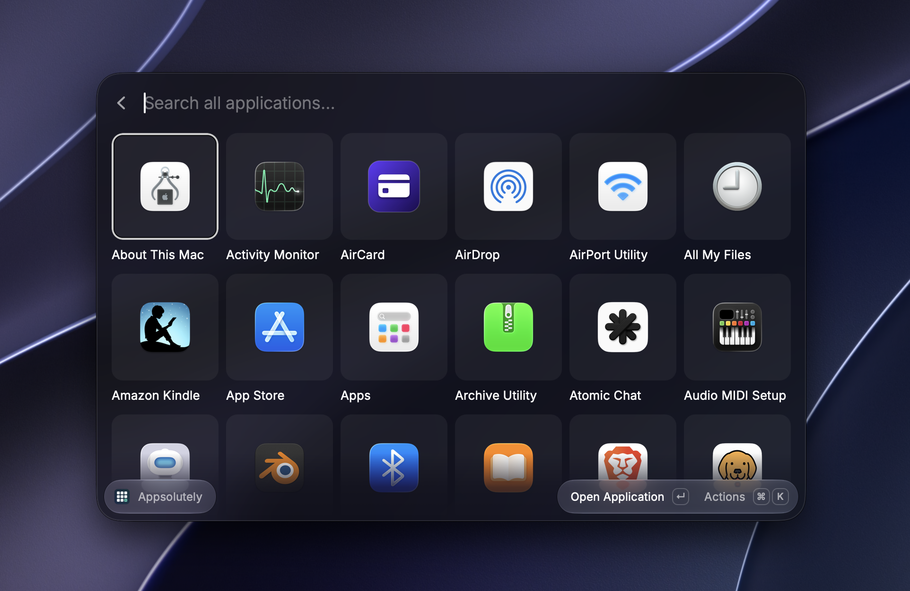
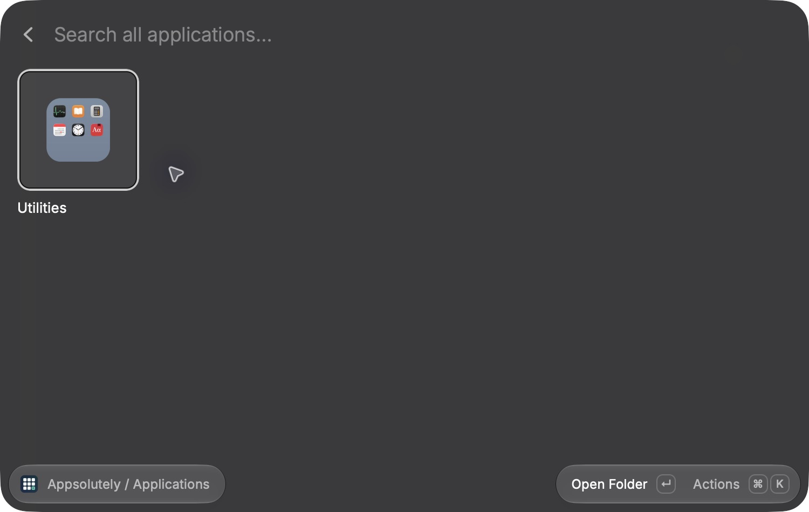
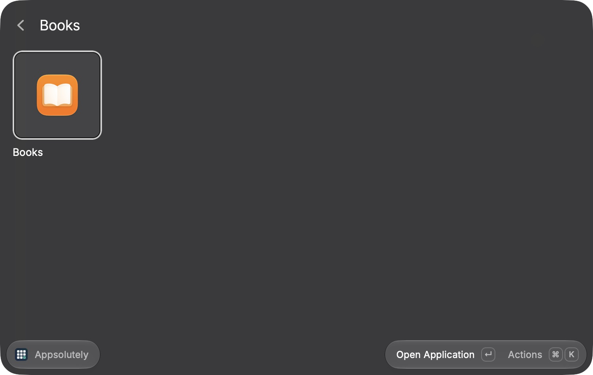

# Appsolutely

**Miss good old App Launchpad before macOS 27?**

A Launchpad-inspired launcher for Raycast.



<details>
<summary>More screenshots: folder previews and search</summary>

**Folder previews** — folder icons combine the applications inside them.



**Global search** — find any installed application, including apps inside folders.



</details>

## Run locally

Requires macOS, Raycast, and Node.js **24 or newer** with npm. This project uses the current stable Raycast SDK, locked in `package-lock.json`.

```sh
npm ci
npm run dev
```

With development running, open Raycast and select **Open Appsolutely**. Arrow keys select a tile; Return opens the application or folder. Raycast supplies mouse interaction and native navigation. Escape clears active search first, then returns through the navigation stack to the parent folder.

## Organize your apps

- Open the Action Panel with **⌘K** for the selected app or folder.
- **Create Folder** makes a folder at Home; inside a folder this becomes **Create Subfolder**.
- **Move to Folder** opens a searchable destination picker, with full folder paths. Select **Appsolutely / Home** to move an app to root.
- Folders also have **Create Subfolder**, **Rename Folder**, **Move Folder**, and **Delete Folder** actions. Moving a folder preserves its contents. Moving it into itself or any descendant is prevented.
- Deleting a folder deletes its subfolders and returns all contained apps to Home. It never deletes or uninstalls an application. Deletion and layout reset require confirmation.
- Empty folders offer the same global actions as populated grids.
- Folder icons preview up to nine of their applications in a 3×3 grid, like macOS Launchpad. Previews update automatically as you organize apps. Direct apps appear first; remaining slots can show apps from nested subfolders. Empty folders use the standard folder icon. [See the native folder preview screenshot](docs/screenshots/folder-preview.png).

| Shortcut | Action                                          |
| -------- | ----------------------------------------------- |
| Return   | Open application or folder                      |
| ⌘K       | Open Action Panel                               |
| ⌘N       | Create folder in the current location           |
| ⌘⇧M      | Move the selected application or folder         |
| ⌘⇧U      | Return selected application to root             |
| ⌘E       | Rename selected folder                          |
| ⌘Return  | Show selected application in Finder             |
| ⌘⇧F      | Open Search All Applications                    |
| ⌘R       | Refresh installed applications                  |
| Escape   | Clear search / return through native navigation |

## Search and refresh

Typing in **any grid** searches all installed applications by name, including apps inside deeply nested folders. Matching is case-insensitive. Search results launch apps directly; folders do not compete with app results. Clearing the search restores the current folder. **Search All Applications** opens a dedicated search view at your current location with the same behavior.

Discovery runs each time the command opens. **Refresh Applications** picks up installs, removals, and renames during a session without resetting organization. Discovery and icon availability follow Raycast's `getApplications()` API and application indexing; Appsolutely does not scan directories itself or hardcode any installed app.

For sharp grid images, Appsolutely reads each discovered app's declared bundle icon and converts it to a transparent PNG up to 512×512 using the built-in macOS `plutil` and `sips` utilities. If that icon is missing, invalid, or fully transparent, it asks macOS's AppKit icon resolver for the actual application icon using the built-in JavaScript/Objective-C bridge. This supports modern asset-catalog icons such as Books without launching the app or requesting Automation access. If neither source produces a visible image, Raycast's `fileIcon` remains the fallback. Icons are loaded in the background with bounded concurrency and cached under Raycast's extension support directory (`icons-v1`, cache schema version 2). Updates to the bundle, icon, or fallback asset catalog invalidate its cache. Cached blank images are rejected and rebuilt automatically. No developer toolchain is required.

Folder previews combine those PNGs into cached 512×512 images under `folder-previews-v1`. The small, pure JavaScript `pngjs` dependency handles PNG decoding and encoding without native addons. Previews preserve transparency, use smooth downsampling, and regenerate when their contents or source icons change. Apps whose icons are not yet available use a generic miniature until their high-resolution icon loads.

Raycast controls grid tile backgrounds and hover/selection highlights. The current native `Grid` API does not expose tile background styling or hover events, so hover-only gray backgrounds cannot be configured by this extension. PNGs retain transparency; Appsolutely does not bake gray backgrounds into them.

## Persistence and application identity

Organization is stored exclusively in Raycast `LocalStorage` under `appsolutely.layout`, using schema version 1. No network requests, accounts, analytics, or additional permissions are used at runtime.

See [Privacy](docs/PRIVACY.md) for the data kept locally and the repository sharing review.

- Every navigation view observes one shared layout and application catalog.
- Saves are serialized. Each operation reads the most recently saved layout, writes it immediately, and updates all open views only after storage succeeds. Failed writes leave the last saved layout visible and report the failure.
- Folder and application order values are persisted. Folders appear first, in creation order; apps are alphabetical by default. Manual reordering is outside this MVP.
- Bundle IDs retain assignments across renames and reinstallations; apps without bundle IDs use their normalized paths. Missing apps keep their saved assignments and disappear from the grid until discovered again. New apps start at Home.
- Repeated discovery records at the same normalized path are collapsed. Distinct paths sharing one bundle ID remain separate, display their installation directories, and can be moved independently. Path-specific assignments take precedence over bundle-level assignments. A copied installation uses its path identity; moving that copy to another path may require assigning it again.
- Paths retain case for case-sensitive macOS volumes. Filesystem aliases and symlinks are not resolved, so discovery aliases at different paths may remain visible separately.
- Malformed data, duplicate IDs, missing references, and folder cycles are repaired. Before edits are enabled, the original is backed up to a timestamped `appsolutely.layout.recovery.*` key. Unknown schema versions are protected from overwrite. Unversioned/v0 drafts migrate to v1 on the next save.

## Development and validation

```sh
npm test                 # Node's built-in runner; no test dependencies
npm run typecheck
npm run lint             # Official Raycast manifest, icon, and ESLint validation
npm run build            # Official Raycast production build
npm run format
node scripts/generate-icon.mjs  # Regenerate the 512×512 extension icon
```

Tests cover hierarchy operations, deep nesting, cycle prevention, application discovery and identity, search, serialization, schema migration, recovery backups, future-version protection, save failures, and concurrent actions.

Source layout:

```text
src/launcher.tsx              Command entry
src/components/              Native grid, items, folder forms, destination picker, actions
src/hooks/                   Shared catalog and layout subscriptions
src/models/                  Application, folder, and storage types
src/services/                Discovery, application identity, storage codec, save queue
src/utils/                   Folder operations and sorting
src/__tests__/               Pure-logic and persistence tests
assets/extension-icon.png    Original 512×512 icon
```
